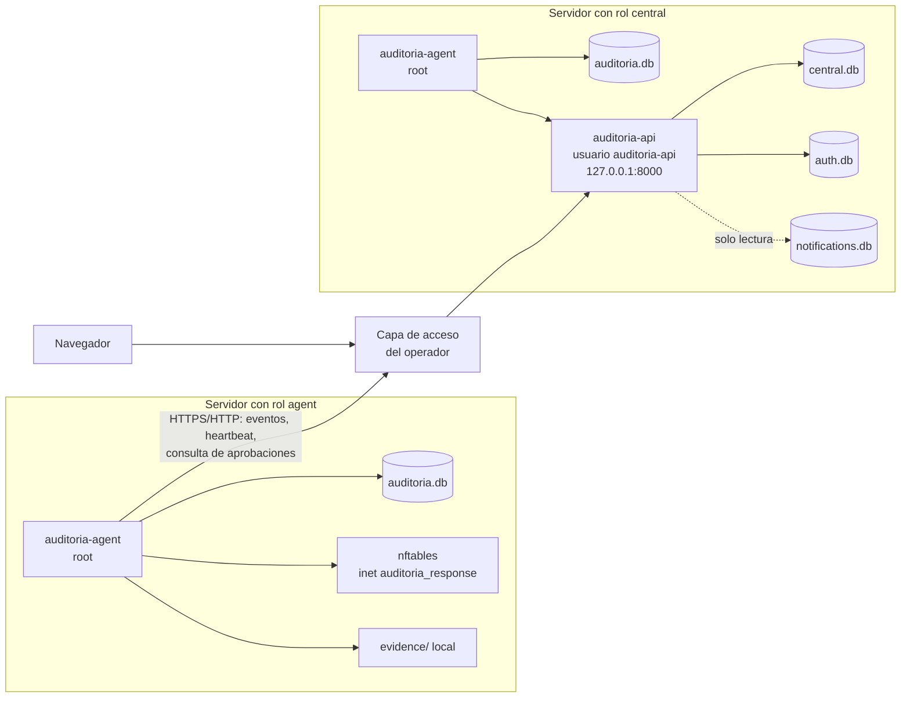
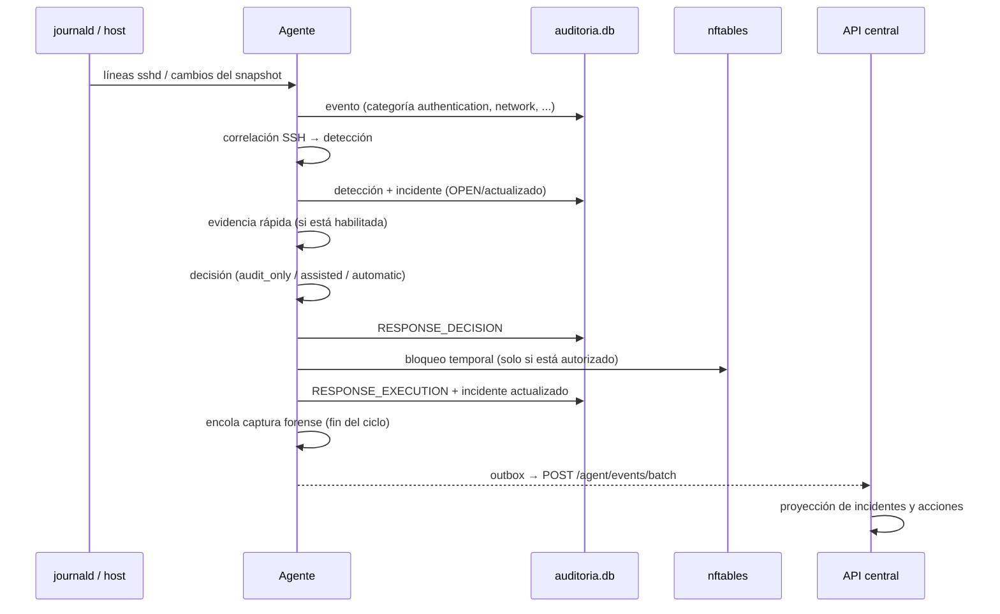

# Arquitectura de Nexora v1.0.0

Este documento describe cómo está organizado Nexora v1.0.0: roles de despliegue,
componentes, bases de datos y el flujo de un evento desde el host hasta el
servidor central.

> Los identificadores internos (`auditoria-*`, paquete `auditoria-system`,
> variables `AUDITORIA_*`) se conservan por compatibilidad. El producto visible
> es Nexora.

## 1. Roles de despliegue

Nexora se instala con uno de dos roles (ver [instalacion.md](instalacion.md)):

| Rol | Servicios | Función |
|---|---|---|
| `central` | `auditoria-agent.service` y `auditoria-api.service` | Recibe eventos de los agentes, ofrece API y dashboard, gestiona usuarios y aprobaciones. También monitorea su propio host con un agente local. |
| `agent` | `auditoria-agent.service` | Monitorea el host, detecta, decide y ejecuta la respuesta local, y sincroniza eventos con el central. |

La API escucha solo en `127.0.0.1:8000`. Exponerla a otros hosts requiere una
capa de acceso que provee el operador (proxy inverso, túnel o similar); Nexora
no la instala ni la configura.

## 2. Responsabilidades del agente

El agente (`python -m app.agent`, clase `ContinuousAgent` en
`app/agent/continuous_agent.py`) corre como `root` porque inspecciona fuentes
del sistema y administra nftables. Sus tareas son:

- **Monitoreo del host.** En cada ciclo toma un *snapshot* y lo compara con el
  anterior:
  - puertos en escucha;
  - usuarios con UID 0 o ≥ 1000;
  - servicios systemd en ejecución;
  - hash SHA-256 de archivos críticos (`/etc/ssh/sshd_config`,
    `/etc/ssh/sshd_config.d`, `/etc/passwd`, `/etc/group`, `/etc/sudoers`,
    `/etc/sudoers.d`, `/etc/ufw/user.rules`, `/etc/ufw/user6.rules`);
  - estado de UFW;
  - `boot_id` del kernel, para detectar reinicios.
- **Lectura de SSH.** Lee `journalctl -u ssh.service` de forma incremental con
  un cursor persistente y correlaciona eventos por IP de origen.
- **Respuesta defensiva.** Decide y, si la configuración lo autoriza, ejecuta
  bloqueos temporales en nftables (ver
  [respuesta-defensiva.md](respuesta-defensiva.md)).
- **Incidentes y evidencia.** Agrupa detecciones en incidentes y, si está
  habilitado, captura evidencia forense local (ver
  [incidentes-y-evidencia.md](incidentes-y-evidencia.md)).
- **Persistencia y sincronización.** Persiste cada evento en `auditoria.db`, en
  `events.jsonl` y en un outbox que un hilo envía al central.
- **Heartbeat.** Un segundo hilo informa periódicamente su presencia al central.
- **Aprobaciones.** En modo `assisted` consulta al central las decisiones de
  aprobación.

### Ciclo del agente

Al arrancar (`run_forever`):

1. inicializa y migra `auditoria.db`;
2. arranca los hilos de sincronización y heartbeat;
3. emite `AGENT_STARTED`;
4. recupera el estado de respuesta: restaura bloqueos vigentes y marca los
   vencidos;
5. marca como `FAILED` las aprobaciones interrumpidas;
6. crea la línea base si no existe.

Cada ciclo (`run_once`, cada `AUDITORIA_INTERVAL` segundos, 10 por defecto):

1. reconcilia en SQLite los bloqueos vencidos (QA-01, best-effort);
2. carga la línea base y toma el *snapshot* actual;
3. si detecta un reinicio (`boot_id` distinto), emite `SYSTEM_REBOOT_DETECTED`
   y termina el ciclo;
4. compara el estado y emite eventos de cambio;
5. lee SSH, correlaciona y procesa cada detección;
6. cierra incidentes inactivos;
7. ejecuta las tareas diferidas: primero aprobaciones, luego cola forense;
8. guarda el estado.

## 3. Responsabilidades del servidor central

La API (`uvicorn app.api.main:app`, usuario `auditoria-api`) concentra:

- autenticación web, sesiones, roles y administración de usuarios (`auth.db`);
- enrolamiento de agentes con token de un solo uso y credencial por agente;
- ingesta idempotente de lotes de eventos por `agent_id` (`central.db`);
- presencia de agentes a partir de heartbeats autenticados;
- proyección de incidentes y acciones de respuesta a partir de los eventos;
- aprobación y rechazo de acciones en modo `assisted` (solo `superadmin`);
- lectura de las notificaciones del nodo central (`notifications.db`, solo
  lectura);
- el dashboard web.

La referencia completa de rutas está en
[referencia-tecnica.md](referencia-tecnica.md#api-http).

## 4. Dashboard

Se sirve desde la misma API, en `/dashboard`, y requiere sesión. Tiene estos
módulos:

| Módulo | Contenido |
|---|---|
| Dashboard | Resumen: health, estado, últimos eventos, detecciones e incidentes. |
| Eventos | Tabla filtrable de eventos. |
| Detecciones | Eventos de categoría `detection`. |
| Incidentes | Lista, detalle y timeline. Las acciones de aprobar o rechazar solo se muestran a `superadmin`. |
| Respuestas | Eventos de categoría `response`. |
| Notificaciones | Notificaciones del nodo central. |
| Servidores | Agentes visibles, presencia y botón para generar un token de registro. |
| Usuarios | Solo `superadmin`. |

El dashboard se refresca cada 30 segundos y usa cabeceras restrictivas: CSP sin
scripts inline, `no-store`, `no-referrer` y `nosniff`.

## 5. Bases de datos

| Base | Nodo | Abre | Versión de esquema |
|---|---|---|---|
| `auditoria.db` | todos | agente (root), lectura y escritura | 5 |
| `central.db` | central | API, escritura en ingesta y decisiones; lecturas en modo `ro` | 3 (WAL) |
| `auth.db` | central | API, lectura y escritura | 3 |
| `notifications.db` | todos | agente en lectura y escritura; API del central en solo lectura | sin versión numérica |

Las tablas y rutas están en
[referencia-tecnica.md](referencia-tecnica.md#bases-sqlite). Las bases rechazan
abrir un esquema más nuevo que el soportado; por eso el rollback restaura
también los datos (ver [backup-restore-rollback.md](backup-restore-rollback.md)).

## 6. Flujo de un evento

Notas sobre el flujo:

- Todos los eventos que emite el agente se persisten localmente. Cuando el
  agente tiene identidad, además se encolan para sincronizar.
- La evidencia forense se guarda solo en el agente; al central llegan
  únicamente metadatos.
- Si el central no está disponible, la respuesta local funciona igual y el
  outbox reintenta con backoff.

## 7. Componentes del código

| Paquete | Contenido principal |
|---|---|
| `app/agent/` | Agente continuo, CLI (`register`), outbox y sincronización, heartbeat, identidad, cliente de aprobaciones. |
| `app/detection/` | Lector de journald para SSH y correlación. |
| `app/response/` | Motor de decisión, ejecutor, planificador y backend nftables, protecciones, reincidencia, recuperación, incidentes y forense. |
| `app/storage/` | `EventRepository` sobre `auditoria.db` y CLI de consulta y retención. |
| `app/api/` | Aplicación FastAPI, rutas de incidentes y archivos del dashboard. |
| `app/agents/` | Enrolamiento, heartbeat, listado de agentes e ingesta de eventos. |
| `app/central/` | Persistencia de `central.db` y proyección de incidentes y acciones. |
| `app/auth/` | Usuarios, sesiones, roles, tokens y credenciales, y CLI `create-superadmin`. |
| `app/notifications/` | Política, repositorio y proveedor Resend. |
| `app/audit/` | Auditoría puntual del host en JSON (`python -m app.audit`). |
| `app/core/` | Configuración del agente y modelo `SecurityEvent`. |

`app/alerts/` existe como paquete vacío; no tiene funcionalidad en v1.0.0.

## 8. Directorios y servicios

| Ruta | Contenido |
|---|---|
| `/opt/auditoria-system` | Código de la release y `.venv` |
| `/etc/auditoria-system/` | `agent.env` y `agent-identity.json` |
| `/var/lib/auditoria-system/` | `auditoria.db`, `notifications.db`, `agent_state.json`, `evidence/` |
| `/var/lib/auditoria-system-auth/` | `auth.db` (solo central) |
| `/var/lib/auditoria-system-central/` | `central.db` (solo central) |
| `/var/log/auditoria-system/` | `events.jsonl` |

Los servicios systemd son `auditoria-agent.service` y `auditoria-api.service`.
El detalle de usuarios, permisos y endurecimiento está en
[seguridad.md](seguridad.md) y [referencia-tecnica.md](referencia-tecnica.md).

## Documentos relacionados

- [motor-defensivo-incidentes.md](motor-defensivo-incidentes.md): diseño del
  motor defensivo.
- [release-v1.0.0.md](release-v1.0.0.md): notas de la versión.
