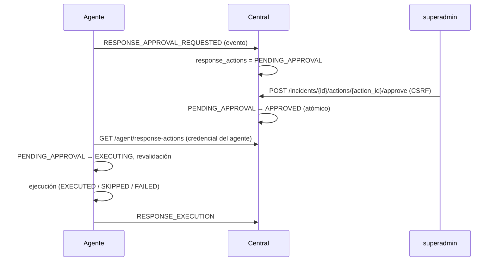

# Incidentes y evidencia forense en Nexora v1.0.0

## 1. Creación de incidentes

Requiere `AUDITORIA_INCIDENTS_ENABLED=true` (valor por defecto).

- **Qué abre un incidente.** Solo las tres detecciones SSH (ver
  [respuesta-defensiva.md](respuesta-defensiva.md#1-qué-activa-la-respuesta)).
- **Cómo se agrupan.** Por la clave `(hostname, IP de origen)`. Una detección
  se suma a un incidente no cerrado si su última actividad cae dentro de
  `AUDITORIA_INCIDENT_GROUPING_SECONDS` (3600 s por defecto). Si no, se abre un
  incidente nuevo.
- **Identificador.** `INC-` seguido de 16 dígitos hexadecimales.
- **Campos.** El tipo es el de la primera detección. La severidad es la más
  alta de las detecciones agrupadas. Se lleva un contador de detecciones.
- **Eventos.** `INCIDENT_OPENED`, `INCIDENT_UPDATED` e `INCIDENT_ERROR`.

### Estados

| Resultado de la respuesta | Estado del incidente |
|---|---|
| Bloqueo `EXECUTED` | `CONTAINED` |
| `NO_ACTION`, `audit_only`, `SKIPPED`, rechazo o vencimiento | `OBSERVED` |
| Acción pendiente en `assisted`, ejecución `FAILED`, o recomendación en `automatic` sin permiso | `OPEN` |
| Sin actividad durante la ventana de agrupación | `CLOSED` |

Un incidente `CONTAINED` no retrocede por un `SKIPPED` posterior. El cierre por
inactividad se evalúa en cada ciclo y alcanza a cualquier incidente no cerrado:
también a los `CONTAINED`, aunque el bloqueo siga vigente, y a los `OPEN` con
una aprobación pendiente. Si esa aprobación se resuelve después del cierre, el
agente vuelve a fijar el estado del incidente (`CONTAINED` u `OBSERVED`), y el
siguiente cierre por inactividad lo devuelve a `CLOSED`.

## 2. Timeline

Cada incidente guarda **vínculos** a eventos, cada uno con un tipo:

| Tipo de vínculo | A qué apunta |
|---|---|
| `event` | Eventos de autenticación de la misma IP en el periodo de la detección (hasta 50). |
| `detection` | La detección. |
| `evidence` | La evidencia forense. |
| `decision` | `RESPONSE_DECISION`. |
| `approval` | `RESPONSE_APPROVAL_REQUESTED`. |
| `execution` | `RESPONSE_EXECUTION`. |

Cómo arma el central la timeline:

- Une esos vínculos con los eventos sincronizados.
- Si un evento todavía no llegó, aparece como no disponible (`available=false`).
- Añade entradas sintéticas `RESPONSE_APPROVAL_GRANTED` y
  `RESPONSE_APPROVAL_DENIED` a partir de las decisiones de aprobación.

## 3. Decisiones, ejecuciones y aprobaciones

Para cada detección, el agente emite:

1. `RESPONSE_DECISION`, con el modo, la acción, el motivo y el nivel de
   reincidencia.
2. `RESPONSE_EXECUTION`, con el estado (`EXECUTED`, `SKIPPED` o `FAILED`) y el
   motivo.
3. En `assisted`: `RESPONSE_APPROVAL_REQUESTED` y, después, según el caso,
   `RESPONSE_EXECUTION` (con `approval_id`, `approved_by` y `approved_at`),
   `RESPONSE_REJECTION_APPLIED` o `RESPONSE_APPROVAL_EXPIRED`.

Flujo de una aprobación:

El central solo envía al agente el identificador de la acción y la decisión. El
agente ejecuta únicamente la acción que él mismo propuso y almacenó. Un agente
no puede aprobar sus propias acciones.

## 4. Evidencia forense

Requiere `AUDITORIA_EVIDENCE_ENABLED=true`. Está desactivada por defecto.

### Cuándo se captura

- Solo para detecciones de severidad `high` o `critical`. En la práctica son
  `SSH_BRUTE_FORCE_ATTEMPT` y `SSH_USER_ENUMERATION_ATTEMPT`;
  `SSH_REPEATED_PREAUTH_ACTIVITY` es `medium` y no se captura.
- Se captura en todos los modos de respuesta, incluido `audit_only`.

### Dos fases

1. **Evidencia rápida**, tomada antes de decidir. Usa solo `psutil`, sin
   procesos externos: conexiones hacia la IP de origen y sesiones activas (hasta
   50 de cada una).
2. **Captura diferida**, después de la contención. Se encola en
   `forensic_capture_queue` y se procesa al final del ciclo, como máximo 3 por
   ciclo, sin retrasar el bloqueo. Lo pendiente sobrevive a reinicios.
   - Un error inesperado se reintenta en ciclos siguientes, hasta 3 intentos en
     total; al agotarlos la captura queda `FAILED` y se emite
     `FORENSIC_EVIDENCE_FAILED`.
   - Un error de validación de la captura (`ForensicEvidenceError`, por ejemplo
     una ruta de evidencia insegura) la marca `FAILED` de inmediato, sin
     reintentos, y emite `FORENSIC_EVIDENCE_FAILED`.
   - Si la captura de esa detección ya existe, se marca `DONE` sin error.

### Comandos de la captura diferida

Todos son de solo lectura y forman una lista cerrada. Se ejecutan sin shell,
con un `PATH` fijo, `LC_ALL=C` y un timeout por comando
(`AUDITORIA_EVIDENCE_COMMAND_TIMEOUT_SECONDS`):

- `ss -tunap`
- `ss -tulpn`
- `who -u`
- `systemctl show ssh.service sshd.service --no-pager --property=…`
- `nft list table inet auditoria_response`
- `journalctl` de `ssh.service` y `sshd.service`, últimos 15 minutos y como
  máximo 300 líneas (solo para detecciones SSH)
- procesos `sshd` y procesos con sockets hacia la IP de origen, obtenidos con
  `psutil` (línea de comandos truncada y sanitizada)

### Redacción de secretos

Antes de guardar, se redactan:

- claves privadas;
- tokens `Bearer`;
- pares `password=`, `token:`, `api_key=`, `secret`, `credential` y similares;
- credenciales embebidas en URLs y opciones `-u usuario:clave`;
- opciones `--password`, `--token`, `--secret` y `--api-key`.

La redacción se basa en patrones; no garantiza eliminar todo dato sensible.

## 5. Almacenamiento local y permisos

| Aspecto | Valor |
|---|---|
| Ruta | `/var/lib/auditoria-system/evidence/<detection_event_id>/` |
| Escritura | Directorio temporal `.tmp-<uuid>` renombrado de forma atómica. |
| Permisos | Directorios 0700 y archivos 0600, creados con `O_EXCL`/`O_NOFOLLOW`. Se rechaza un directorio base que sea symlink. |
| Límites | 128 KiB por artefacto; `AUDITORIA_EVIDENCE_MAX_BYTES` por captura (256 KiB). Lo que excede se marca `truncated`. |
| Retención | `AUDITORIA_EVIDENCE_RETENTION_DAYS` (7 días) y `AUDITORIA_EVIDENCE_MAX_TOTAL_BYTES` (50 MiB). Al superar el total se borran las capturas más antiguas. |
| Estado de una captura | `complete`, `partial` o `failed`. |

La API no lee el sistema de archivos de evidencia.

> **Importante.** `scripts/backup.sh` **no** incluye el directorio `evidence/`.
> Si necesita conservar evidencia más allá de la retención, cópiela mediante su
> propio procedimiento de custodia (ver [seguridad.md](seguridad.md)).

## 6. Qué se sincroniza con el central

| Se sincroniza (como eventos) | No se sincroniza |
|---|---|
| Todos los eventos del agente que tiene identidad: detecciones, decisiones, ejecuciones, aprobaciones, incidentes, recuperación, cambios del host. | El **contenido** de la evidencia (archivos en `evidence/`). |
| Metadatos de evidencia en `FORENSIC_EVIDENCE_CAPTURED`: identificador de captura, estado, bytes, SHA-256 de cada artefacto y `storage="agent-local"`. | La evidencia rápida y el JSON de la cola forense (quedan en SQLite local). |
| | `notifications.db`, `agent_state.json`, `events.jsonl`. |
| | Las tablas locales `response_blocks`, `response_approvals`, `response_offenses` e `incidents`: el central reconstruye incidentes y acciones a partir de los eventos. |

Si el agente no tiene identidad (no está registrado), los eventos se guardan
solo localmente.
