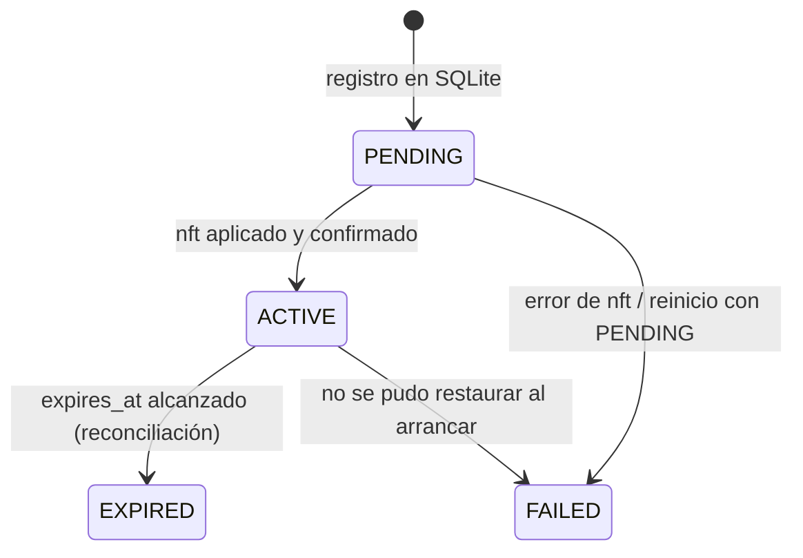

# Respuesta defensiva de Nexora v1.0.0

Cómo decide y ejecuta Nexora los bloqueos temporales, qué lo impide y cómo se
comporta ante reinicios y vencimientos. La configuración está en
[configuracion.md](configuracion.md); el diseño original, en
[motor-defensivo-incidentes.md](motor-defensivo-incidentes.md).

## 1. Qué activa la respuesta

Solo tres detecciones SSH generan una decisión de respuesta:

| Detección | Disparo (misma IP, ventana de 60 s) | Severidad |
|---|---|---|
| `SSH_BRUTE_FORCE_ATTEMPT` | ≥ 10 `SSH_AUTH_FAILURE` | high |
| `SSH_USER_ENUMERATION_ATTEMPT` | ≥ 5 usuarios inexistentes distintos | high |
| `SSH_REPEATED_PREAUTH_ACTIVITY` | ≥ 10 cierres en preautenticación | medium |

No existe un filtro adicional por severidad. Los demás eventos (cambios de
puertos, usuarios, archivos, firewall) se registran, pero no generan respuesta.

## 2. Decisión: por qué una detección no genera acción

El motor (`app/response/engine.py`) devuelve `NO_ACTION` en estos casos, en
este orden:

1. el evento no es de categoría `detection`;
2. el tipo no es uno de los tres de la sección 1;
3. no hay `source_ip`, o no es una IP válida;
4. la IP es loopback, no especificada, multicast o link-local;
5. la IP está en `AUDITORIA_TRUSTED_ADMIN_IPS`.

Las protecciones de Tailscale, sesiones SSH, IPs locales y gateway **no** se
evalúan en la decisión, sino en la ejecución (sección 5).

## 3. Modos

| Modo | Decisión | Firewall |
|---|---|---|
| `audit_only` (por defecto) | `RECOMMEND_BLOCK_IP` o `RECOMMEND_BLOCK_IP_PORT` | Nunca. El resultado registrado es `SKIPPED` («no requiere una acción ejecutable»). |
| `assisted` | `RECOMMEND_*` con `approval_required` y una `proposed_action` | Solo tras la aprobación de un `superadmin` y con el `ALLOW_*` correspondiente. |
| `automatic` | `TEMPORARY_BLOCK_IP` o `TEMPORARY_BLOCK_IP_PORT` si el `ALLOW_*` del alcance está activo; si no, `RECOMMEND_*` | Inmediato, salvo protecciones. |

El agente solo construye un ejecutor real en dos casos: en `automatic` con algún
`ALLOW_*` activo, y en `assisted` para aplicar aprobaciones. En cualquier otro
caso el ejecutor trabaja en simulación.

## 4. Acciones

| Acción | Efecto | Requiere |
|---|---|---|
| `TEMPORARY_BLOCK_IP` | Descarta todo el tráfico entrante desde la IP durante N segundos. | `AUDITORIA_RESPONSE_BLOCK_SCOPE=ip` y `AUDITORIA_ALLOW_TEMPORARY_IP_BLOCK=true` |
| `TEMPORARY_BLOCK_IP_PORT` | Descarta solo `tcp/AUDITORIA_SSH_PORT` (22 por defecto) desde la IP. | `AUDITORIA_RESPONSE_BLOCK_SCOPE=ip_port` y `AUDITORIA_ALLOW_TEMPORARY_IP_PORT_BLOCK=true` |

Ambas acciones duran entre 60 y 86400 s. Sin escalamiento, la duración es
`AUDITORIA_TEMPORARY_BLOCK_SECONDS` (900 s). No existen bloqueos permanentes.

**Idempotencia.** Si ya existe un bloqueo vivo equivalente (mismo host, IP,
acción, protocolo y puerto), no se duplica: el resultado es `SKIPPED` («no se
duplicó»).

## 5. Protecciones

| Protección | Dónde se aplica | Resultado |
|---|---|---|
| Loopback, no especificada, multicast, link-local | decisión y ejecución | `NO_ACTION` / `SKIPPED` |
| IP administrativa (`AUDITORIA_TRUSTED_ADMIN_IPS`) | decisión y ejecución | `NO_ACTION` / `SKIPPED` |
| Tailscale `100.64.0.0/10` y `fd7a:115c:a1e0::/48` | ejecución (planificador) | `SKIPPED` con `protection_rejected` |
| Interfaz `tailscale0` | regla nftables | el tráfico por esa interfaz nunca se descarta |
| Sesiones SSH activas (peers `ESTABLISHED` al puerto 22 y a `AUDITORIA_SSH_PORT`) | ejecución | `SKIPPED` con `protection_rejected` |
| IPs locales del host | ejecución | ídem |
| Gateways por defecto (IPv4 e IPv6) | ejecución | ídem |

Las protecciones dinámicas (sesiones SSH, IPs locales, gateway) se resuelven en
el momento de ejecutar: con `psutil` y con `ip -j route show default`.

**Limitación conocida.** Si `psutil` no puede leer las conexiones o las
interfaces, esa categoría queda vacía, es decir, no protege (*fail-open*). Si el
comando `ip` falla por completo, la ejecución termina en `FAILED` y no bloquea.
Mantenga `AUDITORIA_TRUSTED_ADMIN_IPS` configurada como protección
determinista.

## 6. Ejecución y estados del bloqueo



Secuencia de ejecución (`app/response/executor.py`):

1. Resuelve las protecciones y planifica el bloqueo.
2. Marca como `EXPIRED` los registros vencidos y comprueba que no exista ya un
   bloqueo vivo equivalente.
3. Registra el bloqueo como `PENDING`.
4. Aplica la regla en nftables. Si falla, el registro pasa a `FAILED`.
5. Marca el registro como `ACTIVE`. Si este paso falla, retira la regla y deja
   el registro en `FAILED`.

## 7. nftables, a nivel operativo

| Elemento | Valor |
|---|---|
| Tabla | `inet auditoria_response` |
| Sets por IP | `blocked_ipv4` y `blocked_ipv6`, con `flags timeout` |
| Sets por IP + puerto | `blocked_ipv4_port` y `blocked_ipv6_port` (`dirección . protocolo . puerto`), con `flags timeout` |
| Cadenas | `input` e `input_port`: `hook input`, prioridad `-10`, `policy accept` |
| Exenciones | `iifname "lo"` e `iifname "tailscale0"` hacen `return` |

Cada bloqueo es un elemento de un set con `timeout`; **el kernel lo retira solo
al vencer**. Nexora no gestiona otras tablas ni modifica UFW.

El backend invoca `/usr/sbin/nft` sin shell y con un timeout de 5 s. Valida cada
cambio con `--check` antes de aplicarlo. Si `nft` no está disponible, la
ejecución termina en `FAILED` y el bloqueo no se aplica.

Consulta de solo lectura:

```bash
sudo nft list table inet auditoria_response
```

## 8. Reincidencia y escalamiento

Requiere `AUDITORIA_RESPONSE_ESCALATION_ENABLED=true`.

- **Nivel:** 1 + el número de ofensas previas de la misma IP en el mismo host
  dentro de la ventana (`AUDITORIA_RESPONSE_ESCALATION_WINDOW_SECONDS`, 24 h por
  defecto). El nivel nunca supera la cantidad de niveles configurados.
- **Duraciones por defecto:** nivel 1 = 120 s, nivel 2 = 600 s, nivel 3 =
  3600 s.
- **Vuelta al nivel 1:** cuando no hay ofensas en la ventana.
- **Persistencia:** el nivel se recalcula desde SQLite (`response_offenses`)
  después de un reinicio.
- **Cuándo no cuenta una ofensa:** decisiones `NO_ACTION`, ejecuciones
  rechazadas por protección (`protection_rejected`), IPs con protección
  estática (por ejemplo, Tailscale) y acciones `TEMPORARY_*` que terminan en
  `SKIPPED` (por ejemplo, porque ya existe un bloqueo vigente equivalente).
- **Recomendaciones:** en `audit_only` y `assisted`, una decisión
  `RECOMMEND_*` sí cuenta como ofensa. En esos modos las protecciones dinámicas
  (sesión SSH, IP local, gateway) no se evalúan al decidir, así que no evitan la
  ofensa.

Con el escalamiento desactivado, la duración es
`AUDITORIA_TEMPORARY_BLOCK_SECONDS`.

## 9. Vencimiento y QA-01

Los bloqueos vencen en el kernel por su `timeout`. El registro en SQLite pasa a
`EXPIRED` en tres momentos:

1. **En cada ciclo del agente:** `_reconcile_expired_response_blocks()` al
   inicio de `run_once()` (corrección QA-01).
2. **Antes de cada nuevo bloqueo**, dentro del ejecutor.
3. **Al arrancar el agente**, durante la recuperación.

**QA-01.** Antes de la corrección, un bloqueo vencido en nftables seguía
`ACTIVE` en SQLite hasta reiniciar el agente. Ahora la reconciliación por ciclo
cumple estas condiciones:

- solo actualiza SQLite: no invoca nftables, no restaura ni crea acciones y no
  emite eventos;
- es *best-effort*: ante `PermissionError`, `OSError`, una base ausente o
  inaccesible o un error de SQLite, no interrumpe el ciclo y se reintenta en el
  siguiente;
- no crea la base de datos si no existe.

Efecto visible: el evento `RESPONSE_RECOVERY` del arranque solo cuenta en
`expired_count` los bloqueos que vencieron con el agente detenido.

## 10. Recuperación tras un reinicio

Al arrancar el agente:

1. Los bloqueos vencidos pasan a `EXPIRED`.
2. Los `PENDING` pasan a `FAILED` («quedó pendiente durante un reinicio»).
3. Los `ACTIVE` vigentes se restauran en nftables con su **tiempo restante**,
   aplicando las protecciones del momento. Los que ya no pueden aplicarse pasan
   a `FAILED`.
4. Las aprobaciones en `EXECUTING` pasan a `FAILED`.
5. Se emite `RESPONSE_RECOVERY` con los contadores `table_created`,
   `expired_count`, `failed_pending_count`, `restored_count` y
   `failed_restore_count`. Si algo falla, se emite `RESPONSE_RECOVERY_ERROR`.

Tras un reboot del servidor, nftables arranca vacío y la recuperación vuelve a
crear la tabla y los bloqueos vigentes.
